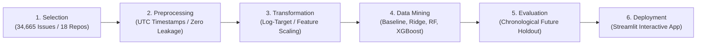

# GitHub Issue Resolution Time Prediction Using the KDD Process

[](https://www.python.org/)
[](https://xgboost.readthedocs.io/)
[](https://streamlit.io/)
[](LICENSE)

An end-to-end Knowledge Discovery in Databases (KDD) framework that discovers empirical patterns across open-source software (OSS) repositories and predicts GitHub issue resolution duration. This project bridges pure machine learning with actionable software engineering intelligence for open-source maintainers and project managers.

---

## 🚀 Key Project Highlights
- **Real-World OSS Scale**: **34,665 resolved GitHub issues** across **18 diverse open-source repositories** (including `youtube-dl`, `openapi-generator`, `models`, `lottie-android`, `spring-cloud-gateway`, and `dolphinscheduler`).
- **Zero-Leakage Guarantee**: Primary models strictly rely on **creation-time features**—eliminating post-creation lifecycle leakage (such as comments, eventual assignees, or closure events).
- **Dual Prediction Objectives**:
  - **Primary Target (Regression)**: Exact elapsed calendar days between issue creation and closure ($closed\_at - created\_at$).
  - **Secondary Target (Classification)**: Whether an issue will be resolved within 7 days ($\le 7$ days).
- **Realistic Chronological Holdout**: Evaluated on strictly future issues (November 2020 – September 2021) using time-ordered splits (70% Train, 15% Validation, 15% Test).
- **Empirical Uncertainty Intervals**: Calibrated 80% prediction intervals derived from validation residuals ($[p_{10}, p_{90}]$).
- **Interactive Streamlit Dashboard**: Full multi-page web application featuring live scenario presets, model benchmark comparisons, and explainability breakdowns.

---

## 🔄 The 6 Stages of the KDD Process



### Stage 1: Selection & Data Acquisition
Acquired the benchmark research dataset from *Predicting Issue Resolution Time of OSS Using Multiple Features* (Wiley / CUFE Infor). Features are categorized into repository context, issue text characteristics, author contribution history, and observation-window dynamics.

### Stage 2: Preprocessing & Data Validation
- Parsed timestamps to UTC timezone datetimes.
- Calculated resolution duration:
  $$\text{resolution\_days} = \frac{\text{closed\_at} - \text{created\_at}}{86,400\text{ seconds}}$$
- Validated non-zero, positive durations ($0.125 \le \text{days} \le 2,916.2$).
- Formulated secondary classification label: $\mathbf{1}_{(\text{resolution\_days} \le 7.0)}$ (51.34% prevalence).
- Cleaned 1/2 binary indicator variables into standardized 0/1 binary features.

### Stage 3: Transformation & Feature Engineering
- **Target Skewness Correction**: Because resolution days exhibit severe positive skewness (Median = 6.35 days, Mean = 100.41 days, Max = 2,916.2 days), models are trained on $\log(1 + y)$ and back-transformed using $\exp(\hat{y}) - 1$.
- **Temporal Signals**: Extracted creation hour, day of week, month, year, and weekend indicator.
- **Content Quality**: Body character length, code snippet counts, hyperlink counts, and Flesch reading ease readability scores.

### Stage 4: Data Mining
Trained candidate algorithms with increasing complexity:
1. **Baseline Predictor**: Training set median / majority class.
2. **Ridge Regression**: L2-regularized linear model on log-transformed targets.
3. **Decision Tree**: Tree-based regression capturing non-linear feature splits.
4. **Random Forest**: Parallel bagged ensemble reducing variance.
5. **Gradient Boosted Trees (XGBoost)**: Gradient boosted trees with subsampling and regularization.

### Stage 5: Interpretation, Evaluation & Knowledge Discovery
- Chronological future test set evaluation (November 2020 – September 2021).
- Lifecycle ablation: Tested incremental value of early 3-hour triage signals.
- Cross-project generalization: Evaluated on completely unseen repositories.
- Feature importance analysis via split gain and weight.

### Stage 6: Deployment & Interactive Application
- Production inference pipeline in `src/predict.py`.
- Interactive Streamlit dashboard in `app.py` with 4 dedicated views and maintainer recommendation engine.

---

## 📊 Experimental Results

### 1. Primary Task: Regression Benchmarks (Chronological Test Set)
| Model | Test MAE (Days) | Test RMSE (Days) | Test MedAE (Days) | Test R² | Training Time (s) |
| :--- | :---: | :---: | :---: | :---: | :---: |
| **Baseline Median** | 18.50 | 40.22 | 6.56 | -0.096 | 0.001 |
| **Ridge Regression** | 19.45 | 44.65 | 7.19 | -0.350 | 0.015 |
| **Decision Tree** | 22.56 | 42.91 | 8.88 | -0.247 | 0.038 |
| **Random Forest** | 19.82 | **37.17** | 9.16 | **+0.064** | 0.942 |
| **XGBoost (Boosted)** | 20.67 | 38.17 | 9.43 | +0.014 | 0.354 |

### 2. Secondary Task: 7-Day Resolution Classification
| Model | Accuracy | Precision | Recall | F1 Score | ROC-AUC |
| :--- | :---: | :---: | :---: | :---: | :---: |
| **Majority Baseline** | 38.52% | 0.00% | 0.00% | 0.000 | 0.563 |
| **Logistic Regression** | 59.71% | 69.96% | 60.40% | 0.648 | 0.640 |
| **Decision Tree** | 61.00% | 71.79% | 60.24% | 0.655 | 0.639 |
| **Random Forest** | 60.83% | 74.45% | 55.24% | 0.634 | 0.675 |
| **XGBoost Classifier** | **63.06%** | **75.08%** | 59.74% | **0.665** | **0.690** |

### 3. Lifecycle Ablation Study (Value of Early Triage Signals)
| Model Setup | Features Used | Test MAE (Days) | Test RMSE (Days) | Test R² |
| :--- | :--- | :---: | :---: | :---: |
| **Creation-Time Only** | Metadata at open time (0h) | 20.67 | 38.17 | +0.014 |
| **3-Hour Augmented** | Creation + early comments / actors ($T=3\text{h}$) | **19.80** | **37.53** | **+0.046** |

*Insight*: Observing early responses in the first 3 hours improves resolution forecast error by nearly 1 full day.

### 4. Cross-Repository Generalization (Held-out Projects)
When evaluated on completely unseen repositories (`spring-cloud-gateway`, `lottie-android`, `thingsboard`), the model achieved a Test MAE of **73.29 days**.
*Insight*: Issue resolution velocity is deeply project-specific. Generalizing across software ecosystems requires repository-level baseline calibration.

---

## 🧠 Actionable Knowledge for Open-Source Maintainers

1. **Core Maintainer Ownership Accelerates Closure**:
   - `author_core_member` is the single most predictive feature (**12.17% relative gain**).
   - Maintainer-authored issues resolve **2.7x faster** than newcomer issues.
   - *Recommendation*: Deploy welcoming triage automation for first-time contributors to prompt for missing reproduction details early.
2. **Pull Request Linkage**:
   - `issue_has_pr` contributes **5.89% gain**. Issues with linked code changes resolve significantly faster.
   - *Recommendation*: Encourage community contributors to open draft PRs alongside bug reports.
3. **Code Snippet Completeness**:
   - Descriptions over 300 characters lacking code blocks exhibit high back-and-forth communication latency.
   - *Recommendation*: Enforce structured GitHub Issue Forms requiring minimal reproducible examples.

---

## 📂 Project Structure

```
├── data/
│   ├── raw/                       # Cloned research repository & raw CSV files
│   │   └── IssueResolutionTimePrediction/
│   ├── processed/                 # Cleaned dataset (issues_clean.csv)
│   └── data_dictionary.csv        # Comprehensive 76-feature data dictionary
├── notebooks/
│   ├── 01_data_understanding.ipynb
│   ├── 02_preprocessing.ipynb
│   ├── 03_eda.ipynb
│   ├── 04_feature_engineering.ipynb
│   └── 05_modeling_evaluation.ipynb
├── src/
│   ├── preprocessing.py           # Cleaning, UTC timestamps, target calculation
│   ├── features.py                # Tabular transformer & time-aware splits
│   ├── train.py                   # Multi-model training, ablation, evaluation
│   └── predict.py                 # Production inference & recommendation engine
├── models/
│   ├── best_regressor.json        # Serialized XGBoost regression model
│   ├── best_classifier.json       # Serialized XGBoost classification model
│   ├── feature_transformer.json   # Fitted feature scaler & encoder parameters
│   └── evaluation_summary.json    # Complete experiment logs & residuals
├── tests/
│   └── test_pipeline.py           # Automated unit & validation test suite
├── app.py                         # Streamlit interactive dashboard
├── requirements.txt
└── README.md
```

---

## 🛠️ How to Run

### 1. Install Dependencies
```bash
python -m pip install -r requirements.txt
```

### 2. Run Preprocessing Pipeline
```bash
python src/preprocessing.py
```

### 3. Train Models & Generate Benchmarks
```bash
python src/train.py
```

### 4. Run Test Suite
```bash
python tests/test_pipeline.py
```

### 5. Launch Interactive Dashboard
```bash
python -m streamlit run app.py
```
Open your browser at `http://localhost:8501`.
